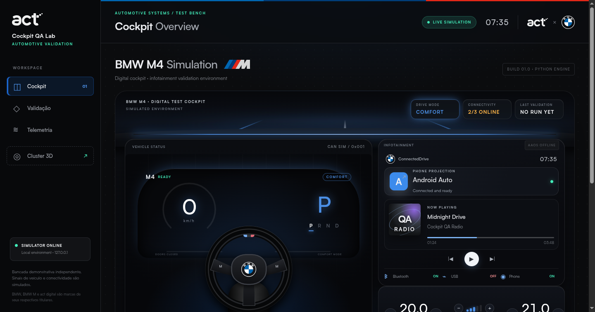
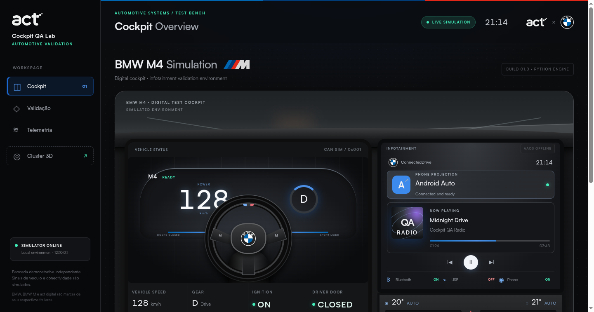
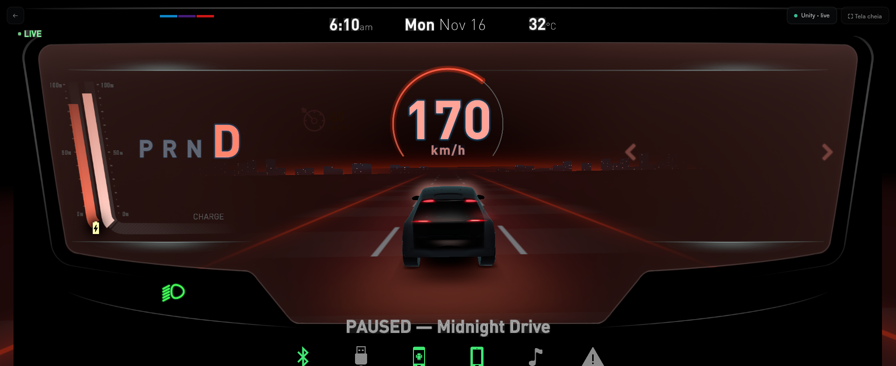
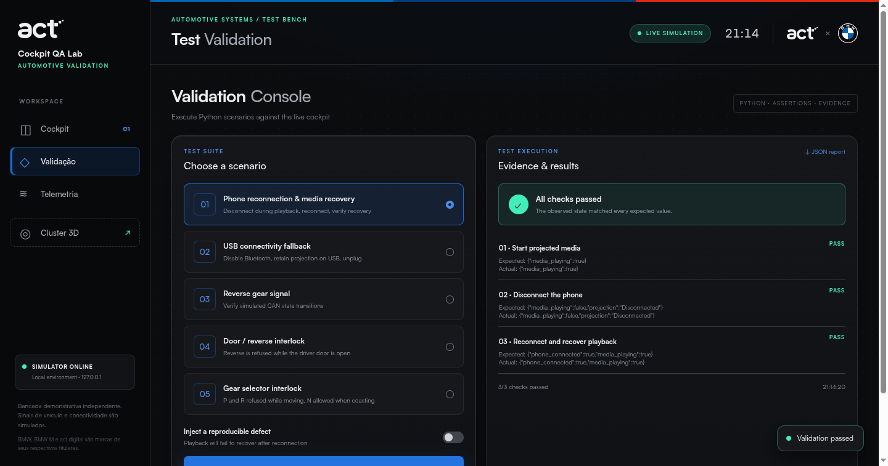
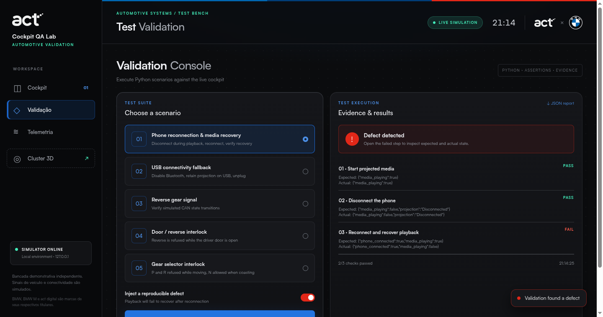
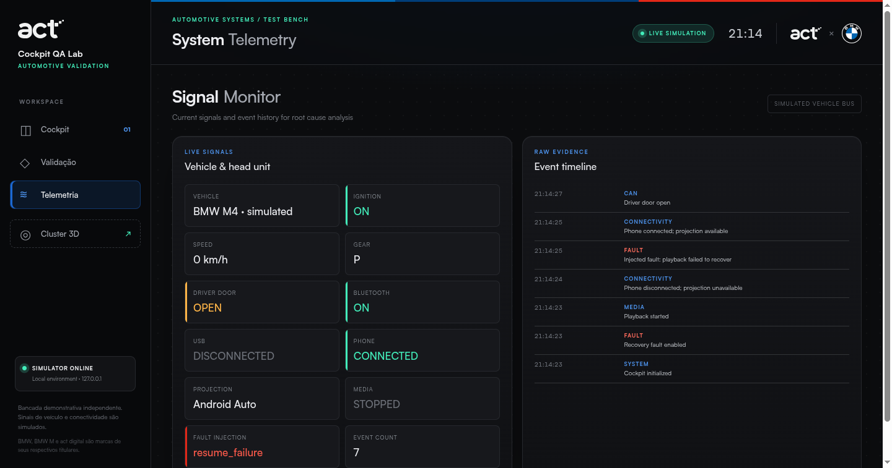
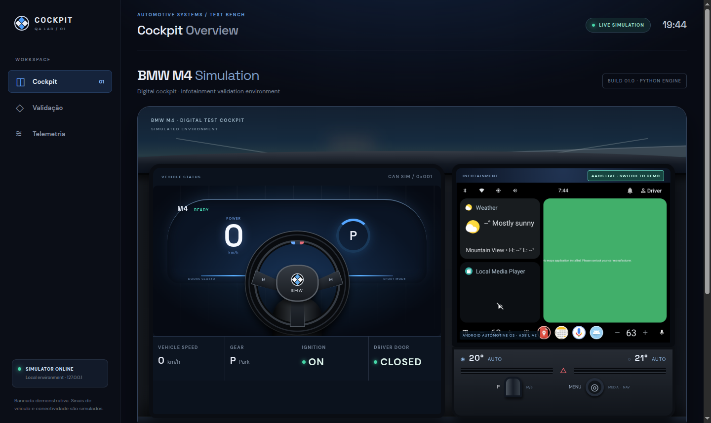

<div align="center">

# Cockpit QA Lab

**BMW M4-inspired infotainment test bench — simulated vehicle, live HMI and automated validation with expected-vs-actual evidence.**

[](https://cockpit-qa-lab-ia85.onrender.com)
[](https://github.com/joaofiorentin1/cockpit-qa-lab/actions/workflows/cockpit-qa.yml)




</div>

A Python state machine drives a visible cockpit, connectivity events, simulated vehicle signals, and automated validation with expected versus actual evidence.

> The cabin, Android Auto status, Bluetooth, USB and vehicle signals are simulated. The **AAOS LIVE** switch can display and touch a real Android Automotive OS emulator in the multimedia screen. It does not connect to a BMW, CarPlay, or a real Android Auto head unit.

## Highlights

- **Deterministic simulator** — gear, speed, door, ignition, Bluetooth, USB and phone projection modelled as a Python state machine with safety interlocks.
- **5 validation scenarios** — run from the UI, each step reports `expected` vs `actual` state and exports a JSON report.
- **Reproducible defect injection** — flip one switch to make a test fail on purpose and walk through root cause analysis.
- **Real Android Automotive** — the official AAOS emulator can be streamed and touched inside the infotainment screen; speed is injected into VHAL.
- **3D instrument cluster** — Unity WebGL cluster that follows the simulator live (gear, speed, media, connectivity), with a road that scrolls with speed, a speed arc, a P R N D selector, a distant skyline and a BMW-inspired Comfort (blue) / Sport (red, above 120 km/h) theme. [Open it online](https://cockpit-qa-lab-ia85.onrender.com/unity/).
- **CI** — unit, API, contract and Selenium browser tests on GitHub Actions.
- **Documented decisions** — 11 [ADRs](docs/adr/README.md) explain the trade-offs behind the design.

## Screenshots

<table>
  <tr>
    <td width="50%"><br><sub><b>Driving</b> — speed and gear streamed from the simulator to the cluster.</sub></td>
    <td width="50%"><br><sub><b>Cluster 3D</b> — Unity WebGL cluster; switches from Comfort blue to Sport red above 120 km/h.</sub></td>
  </tr>
  <tr>
    <td><br><sub><b>Validation · pass</b> — phone reconnection & media recovery, 3/3 checks.</sub></td>
    <td><br><sub><b>Validation · defect</b> — injected fault caught with expected vs actual evidence.</sub></td>
  </tr>
  <tr>
    <td><br><sub><b>Telemetry</b> — colour-coded live signals and timestamped event trail for RCA.</sub></td>
    <td><br><sub><b>AAOS live</b> — real Android Automotive emulator rendered and touchable in the HMI.</sub></td>
  </tr>
</table>

## Run the cockpit

**Live demo:** https://cockpit-qa-lab-ia85.onrender.com — hosted on a free instance, so the first request after idle can take ~30 s. The AAOS emulator integration is local-only.

To run locally:

Requires Python 3.10+; the app itself has no third-party dependencies.

```bash
git clone https://github.com/joaofiorentin1/cockpit-qa-lab.git
cd cockpit-qa-lab
python3 server.py
```

Open **http://127.0.0.1:8765**. Stop with `Ctrl+C`.

In **Cockpit**, use the event controls to change phone, Bluetooth, USB, reverse gear, door and speed. In **Validação**, select a scenario and click **Run validation**. The browser switches to the cockpit while the Python runner drives it, then returns to the report. Enable **Inject a reproducible defect** to demonstrate a failing reconnection test. **Telemetria** shows current signals and the event timeline. The report can be downloaded as JSON.

### Show the real Android Automotive emulator in the dashboard

This uses the official AAOS image, ADB screen capture, and ADB touch input. The emulator image is a large download. From `cockpit-qa-lab`, in a second terminal:

```bash
bash scripts/setup_aaos.sh
bash scripts/start_aaos.sh
```

Wait until `adb -s emulator-5556 shell getprop sys.boot_completed` returns `1`. The **AAOS READY · SHOW LIVE** button then appears in the multimedia header. Click it to switch from the simulated media UI to the actual Android Automotive screen. Clicking the image sends a touch to the emulated Android device. The speed slider also sets the real AAOS VHAL speed, gear and parking brake; 72 km/h in the cockpit appeared as approximately 45 mph on the emulated instrument cluster. Without `/dev/kvm`, the first boot can be slow. The Web cockpit still runs independently.

The live Android screen is **a separate integration track**: the Python media recovery scenarios currently assert the simulated connectivity state, not AAOS system behavior or VHAL properties.

## Guided walkthrough

1. Open the cockpit: a visual HMI backed by a deterministic Python simulator.
2. Run **Phone reconnection & media recovery** without fault injection. It should pass 3/3 assertions.
3. Run it again with fault injection. It should fail 2/3 assertions, showing expected versus actual `media_playing` state.
4. Open **Telemetria** to follow the event trail used for root cause analysis.
5. If AAOS is running, switch the multimedia display to **AAOS LIVE** to see the actual emulated Android UI.

## Architecture

```text
Browser HMI (HTML/CSS/JS)
    │ REST + polling
    ▼
Python HTTP server ──► Cockpit state machine ──► event log
    │                         ▲
    └──► Python QA runner ────┘
              │
              ▼
      JSON report: steps, expected/actual, final state

Optional: Selenium → browser HMI
Optional: Appium/UiAutomator2 → AAOS UI smoke test
Optional: SocketCAN → demo signal adapter → REST API
```

## Design decisions

The reasoning behind the architecture — zero-dependency backend, deterministic state machine, interlocks as refused commands, polling vs WebSockets, the AAOS boundary and the test pyramid — is recorded as **[Architecture Decision Records](docs/adr/README.md)**.

## Run automated tests

Core tests, no dependencies:

```bash
python3 -m unittest discover -s tests -p 'test_cockpit.py' -v
```

Browser test, with Chromium/Chrome and matching driver installed:

```bash
python3 -m venv .venv
.venv/bin/pip install -r requirements-dev.txt
.venv/bin/python -m unittest discover -s tests -p 'test_ui_selenium.py' -v
```

If `python3 -m venv` is unavailable, use `uv venv .venv` and `uv pip install --python .venv/bin/python -r requirements-dev.txt`. The Selenium test starts its own local server, checks that the BMW cockpit is visible, injects a reproducible fault, checks the failed assertion and saves screenshots to `artifacts/`.

## Android Appium smoke test

With AAOS booted, install the Appium server, UiAutomator2 driver, and Python client:

```bash
npm install
APPIUM_HOME="$PWD/.appium" ./node_modules/.bin/appium driver install uiautomator2
python3 -m venv .venv
.venv/bin/pip install -r requirements-android.txt
ANDROID_SDK_ROOT="${ANDROID_SDK_ROOT:-$HOME/android-sdk}" ANDROID_HOME="${ANDROID_SDK_ROOT:-$HOME/android-sdk}" APPIUM_HOME="$PWD/.appium" npm run appium
```

In another terminal, run `.venv/bin/python adapters/appium_android_smoke.py`. It reads the Android UI hierarchy, sends a BACK key, and saves a real emulator screenshot. This is separate from the simulated media recovery scenario.

## Other integrations

- **SocketCAN:** `adapters/socketcan_bridge.py vcan0` receives frames from a Linux CAN interface and forwards demo speed, gear and door signals to the cockpit. IDs `0x100`, `0x101`, `0x102` are a **project-defined demo contract**, not BMW vehicle IDs or a BMW DBC. A `vcan0` interface must be created outside the app first.
- **Android Auto:** Google's [Desktop Head Unit](https://developer.android.com/training/cars/testing/dhu) can be used for a later hardware-backed track with a phone. This demo does not automate the DHU.
- **CarPlay/iOS:** future hardware-backed track; no simulated result is presented as an Apple integration.

## Stack mapping

| Area | Where it is covered |
|---|---|
| Python | Simulator, HTTP API, QA runner, assertions |
| Selenium / Web | Real browser smoke test and screenshots |
| Appium / UI Automator / Android | Official AAOS emulator displayed in the dashboard; Appium smoke adapter |
| Linux Shell | Local commands, optional SocketCAN adapter |
| Bluetooth / USB / Android Auto | Simulated connectivity state and scenarios |
| CAN / embedded systems | Simulated vehicle signals, optional SocketCAN input, live AAOS VHAL speed injection |
| Git / CI | Source-controlled app and GitHub Actions workflow |
| Root cause analysis | Timestamped events, expected/actual values, exported JSON |

The UI uses the BMW name for a demonstration simulation and contains an original CSS dashboard and steering wheel. It is not affiliated with BMW.
