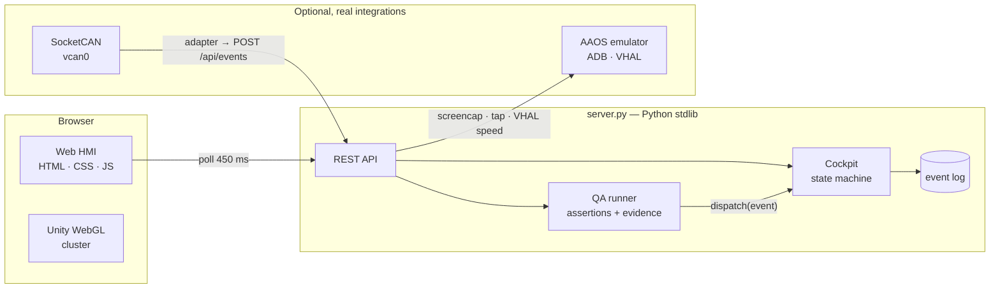

# Architecture Decision Records

Short, numbered records of the decisions that shape Cockpit QA Lab: **what** was decided, **why**, and **what it costs**. Each ADR is immutable once accepted; a change of direction is a new ADR that supersedes the old one.

Format: lightweight [MADR](https://adr.github.io/madr/) — Context → Decision → Consequences → Alternatives considered. New records start from [`template.md`](template.md).

## System at a glance

## Index

| # | Decision | Status |
|---|---|---|
| [0001](0001-record-architecture-decisions.md) | Record architecture decisions | Accepted |
| [0002](0002-zero-dependency-python-backend.md) | Zero-dependency Python standard-library backend | Accepted |
| [0003](0003-deterministic-state-machine-single-source-of-truth.md) | Deterministic state machine as the single source of truth | Accepted |
| [0004](0004-safety-interlocks-as-refused-commands.md) | Safety interlocks as refused commands | Accepted |
| [0005](0005-in-process-qa-runner-with-evidence.md) | In-process QA runner with expected-vs-actual evidence | Accepted |
| [0006](0006-fault-injection-as-simulator-state.md) | Reproducible fault injection as simulator state | Accepted |
| [0007](0007-http-polling-over-websockets.md) | HTTP polling instead of WebSockets | Accepted |
| [0008](0008-real-aaos-via-adb-as-separate-track.md) | Real Android Automotive via ADB, as a separate track | Accepted |
| [0009](0009-hardware-adapters-as-api-clients.md) | Hardware adapters are thin API clients with a demo CAN contract | Accepted |
| [0010](0010-layered-test-strategy.md) | Layered test strategy with isolated servers | Accepted |
| [0011](0011-honest-simulation-and-brand-boundaries.md) | Honest simulation and brand boundaries | Accepted |
| [0012](0012-seeded-monkey-testing-for-safety-invariants.md) | Seeded monkey testing for safety invariants | Accepted |
